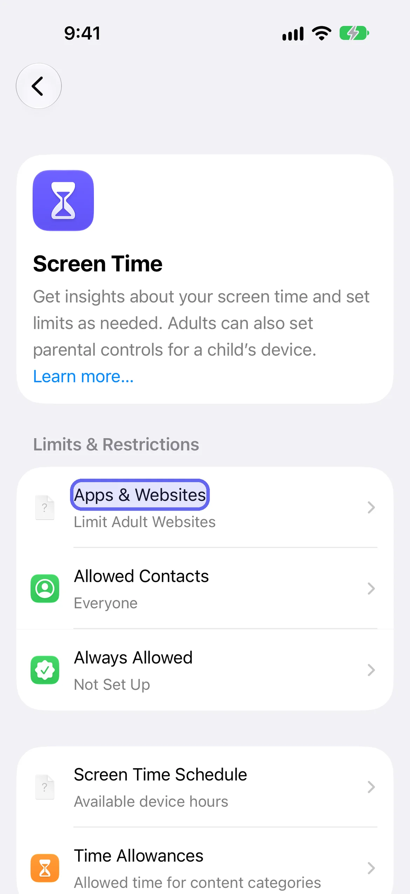

The best Instagram blocker for iPhone is the one you can't talk yourself out of. Seven options are below, most of them free, from Instagram's own reminder to Apple's Screen Time to [LockPact](/go/b-best-instagram-blocker-iphone/), a free-to-use app where a partner approves any unlock. For each: what it stops, who can turn it off, and what it costs. Prices were checked October 15, 2026.

If you just want the step-by-step for one option, our [guide to locking Instagram after a time limit or during certain hours](/blog/instagram-vs-lockpact-blocking/) has the exact taps. This page is for choosing.

## What should you look for in an Instagram blocker?

Ask one question first: who can turn it off? Almost every tool below can be switched off by you, in seconds, from Settings. That's not a flaw to be shocked by; Apple gives apps no way to prevent it. What differs is how much stands in the way: nothing, a pause, a passcode you know, or a person.

The second question is whether you want to lock the app or just slow it down. Friction tools (a pause, a task) work for people already trying to change. Locks work better for people who keep tapping through.

## How do the best Instagram blockers compare?

| Option | What it does | Bypass path | Who can turn it off | Cost |
|---|---|---|---|---|
| **Instagram's daily reminder** | Tells you when you've hit your time | Dismiss the message | You, one tap | Free |
| **Screen Time Time Allowances (App Limits on iOS 26)** | A daily budget for Instagram's category | Enter the passcode, or turn Screen Time off | You, unless someone else holds the passcode | Free (built in) |
| **Screen Time Schedule (Downtime on iOS 26)** | Hours when Instagram is off | Enter the passcode, or turn the schedule off | You, unless someone else holds the passcode | Free (built in) |
| **one sec** | A pause before Instagram opens | Walk through the pause | You, instantly | Free essentials; Pro $19.99/year |
| **ScreenZen** | Friction delays, optional streak sharing | Walk through the delay | You | Free (tips only on its listing) |
| **Opal** | Scheduled blocking with one free rule | Revoke its Screen Time access in Settings | You, unless a partner holds your passcode | Free; Pro $99.99/year |
| **LockPact** | A lock your partner has to approve | Revoke in Settings, and your partner is alerted | You, in Settings, and your partner finds out | Free to use |

## 1. Instagram's own daily reminder

Instagram's Help Center describes a daily reminder you can set from your activity settings that tells you how much time you've spent on the app. It's a nudge, not a lock: it shows a message and you can carry on. Menu labels inside Instagram change often, so open Your Activity in the app to find it. It's worth setting for awareness, and it stops nothing on its own.

**What it stops:** nothing. **Who turns it off:** you. **Cost:** free.

## 2. Screen Time Time Allowances (App Limits on iOS 26)

Apple's built-in budget works by category on iOS 27: **Settings → Screen Time → Time Allowances**, then **Manage Categories** to see which category holds Instagram. Apple says apps use up their category's allowance or the daily total. On iOS 26 and earlier it's **App Limits → Add Limit**, and Apple's note for those versions is that limits can be ignored by default. It becomes a lock when someone else sets the passcode.

**What it stops:** Instagram after your daily time, if the passcode isn't yours. **Who turns it off:** whoever knows the passcode. **Cost:** free.

## 3. Screen Time Schedule (Downtime on iOS 26)

A schedule covers hours instead of minutes: **Settings → Screen Time → Screen Time Schedule**, then turn on **Schedule** and set a window. On iOS 26 and earlier it's **Downtime**, and with a passcode set, **Block at Downtime** makes restricted apps unavailable. It's the right shape for late-night scrolling.

**What it stops:** Instagram during your scheduled hours. **Who turns it off:** whoever knows the passcode. **Cost:** free.

## 4. one sec

one sec puts a deliberate pause before Instagram opens and asks whether you really want it. Its essentials are free and Pro is $19.99 a year on its App Store listing. It's honest about its limits: it works if you already want to change, and you can walk straight through the pause. See [one sec vs. LockPact](/blog/onesec-vs-lockpact/).

**What it stops:** the reflex tap. **Who turns it off:** you. **Cost:** free essentials; Pro $19.99/year.

## 5. ScreenZen

ScreenZen adds friction delays before the apps you choose, with optional streak sharing. Its App Store listing shows it as free, with tips as the only in-app purchases. Like one sec, it's friction, not a lock.

**What it stops:** the reflex tap. **Who turns it off:** you. **Cost:** free.

## 6. Opal

Opal schedules blocking sessions and has the most polished design here. Its free plan allows one rule; Pro is $99.99 a year (opalapp.com/pricing). It's a solo tool, so you're still the one who can turn it off, unless a partner holds your Screen Time passcode. We compare it in [Opal vs. LockPact](/blog/opal-vs-lockpact/).

**What it stops:** Instagram on your schedule. **Who turns it off:** you. **Cost:** free for one rule; Pro $99.99/year.

## 7. LockPact

LockPact is the one on this list built around a person. You and a partner each choose apps to lock on your own phones, and unlocking Instagram means asking your partner to approve it. If you bypass the lock in Settings, which Apple always allows, your partner is told straight away. We list it last because it needs someone else, and for the right pair that's the point.

The free-to-use part is the whole partner flow; the only optional purchases are tips and Willpower Waivers, which skip the short video before an unlock request. [Get LockPact on the App Store](/go/b-best-instagram-blocker-iphone/).

**What it stops:** Instagram, until your partner says yes. **Who turns it off:** you, from Settings, and your partner finds out. **Cost:** free to use.

## Which Instagram habit are you trying to fix?

Match the tool to the habit. For late-night scrolling, use a Screen Time Schedule window and a partner-held passcode. For checking Instagram dozens of times a day, a pause app like one sec targets the reflex. For long sessions at work, a Time Allowance caps the category. For a habit you've failed to limit before, you need the off-switch to belong to someone else.

- **Late at night:** a schedule window covering bedtime, with the passcode held by someone else.
- **Reflex checking:** one sec or ScreenZen, because the problem is the tap, not the length.
- **Long daytime sessions:** a Time Allowance for the category Instagram sits in.
- **You've tried and tapped through:** LockPact or a partner-held passcode.

## How do you limit Instagram with Screen Time on iOS 27?

To limit Instagram with Screen Time on iOS 27, check which Time Allowance category holds it, set that category's allowance or add it to a Screen Time Schedule window, and block instagram.com under Apps & Websites. Then have someone else hold the passcode so the limit can't be undone in a tap. Each step is below, with the screens.

1. Open **Settings → Screen Time → Time Allowances → Manage Categories**, tap a category, and check whether Instagram is in it.
2. Set that category's allowance with its slider, or add it to a window in **Screen Time Schedule**.
3. Open **Settings → Screen Time → Apps & Websites**, tap the add button, and enter instagram.com so the website is covered too.
4. Ask a partner to set the passcode under **Manage Screen Time → Lock Screen Time Settings**.

For a longer version of these steps, see [how to lock Instagram after a time limit](/blog/instagram-vs-lockpact-blocking/).

## Which Instagram blocker should you pick?

If you want awareness, use Instagram's reminder or one sec. If you want a hard stop with no one else involved, use Screen Time Downtime and accept that you hold the passcode. If you've set limits before and tapped through every time, you need the off-switch to belong to someone else, either through a Screen Time passcode they hold or through LockPact.

No Instagram blocker makes quitting impossible. The best ones make it slower, more visible, and a conversation. For the exact taps on the built-in route, read [how to lock Instagram after a time limit](/blog/instagram-vs-lockpact-blocking/), and for a version that covers every app, [how to lock (or block) apps on iPhone](/blog/how-to-lock-apps-on-iphone/).
