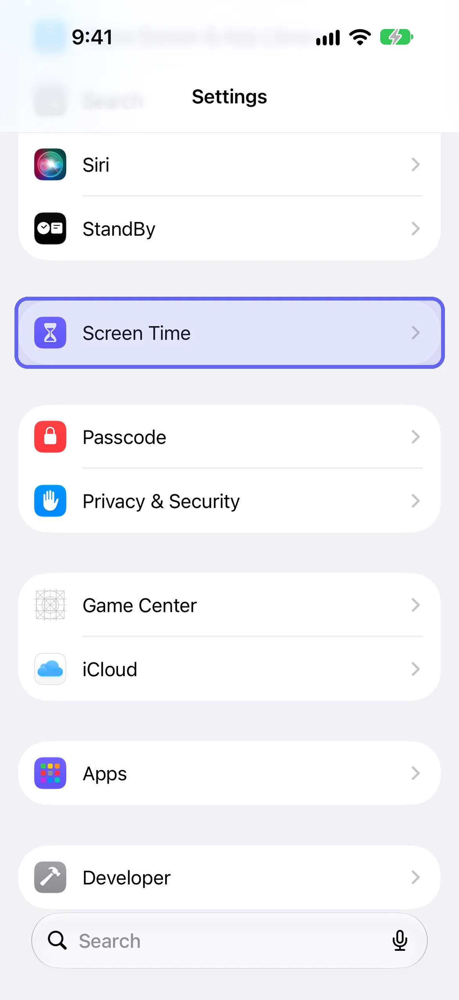
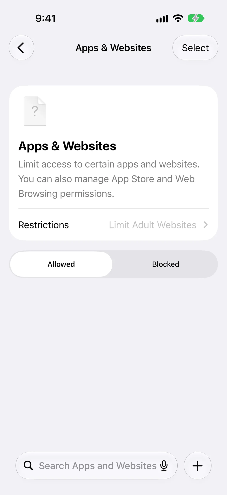
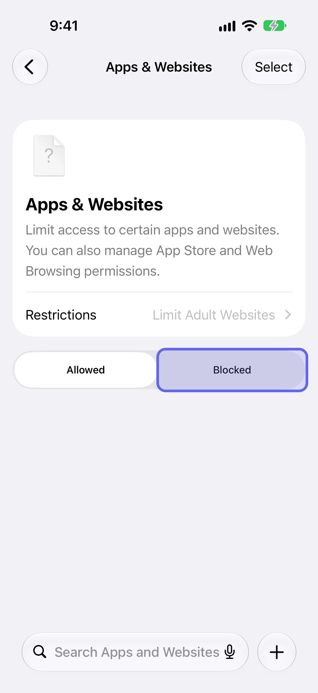
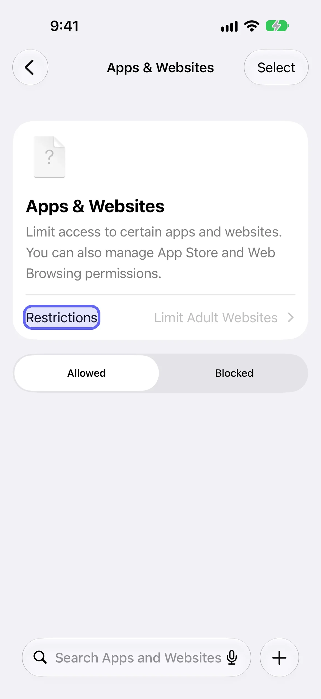

To block a website on iPhone with iOS 27, open **Settings → Screen Time → Apps & Websites**, tap **Blocked**, tap the add button, and type the site's address. It's free and built in. The catch is that you can undo it yourself, so this guide also shows how to lock websites with [LockPact](/go/b-how-to-block-websites-on-iphone/), a free-to-use app where a partner has to approve before a site opens again. It's written for adults managing their own phone.

## How do you block a website on iPhone?

On iOS 27, block a website from Apps & Websites in Screen Time. Open Settings, tap Screen Time, tap Apps & Websites, tap the Blocked tab, and tap the add button. A sheet titled Block Website asks you to type one URL or paste many. Confirm it and the site joins your Blocked list. This is the setting most people mean by "block a website on Safari."

1. Open **Settings** and tap **Screen Time**.
2. Tap **Apps & Websites**.
3. Tap the **Blocked** tab.
4. Tap the **add button** at the bottom right.
5. On the **Block Website** sheet, type one URL or paste several, then tap the checkmark.

Screen Time on iOS 27 changed from earlier versions, so many guides still describe the old path. We ran these steps on an iOS 27.0 Simulator on October 16, 2026; the labels match Apple's iOS 27 guide for the Apps & Websites screen.

**On iOS 26 and earlier:** open **Settings → Screen Time → Content & Privacy Restrictions**, turn it on, tap **App Store, Media, Web & Games**, then **Web Content**. Select **Limit Adult Websites**, tap **Add Website** below **Never Allow**, and enter each URL. That's Apple's documented path for iOS 26.

## How do you block adult websites on iPhone?

Apps & Websites has a Restrictions row at the top that shows the website filter. On the iOS 27 build we tested it reads Limit Adult Websites. Tap Restrictions to see the filter. Apple's iOS 27 guide describes three filtering choices for a child's device: unrestricted access, Limit Adult Websites, or Approved Websites Only. Check which options your own screen offers.

1. Open **Settings → Screen Time → Apps & Websites**.
2. Tap **Restrictions**.
3. Choose the website filter you want.

## Where did the website block move between iOS 26 and iOS 27?

On iOS 27 the website block moved from Content & Privacy Restrictions to Apps & Websites. The Web Content screen that older guides describe isn't in the iOS 27 Screen Time list we tested, and Apple's iOS 27 pages describe Apps & Websites with Allowed and Blocked tabs instead. If your menus differ, check your iOS version in Settings, General, About.

| | iOS 27 | iOS 26 and earlier |
|---|---|---|
| Where | Settings → Screen Time → **Apps & Websites** | Settings → Screen Time → **Content & Privacy Restrictions** |
| Block one site | **Blocked** tab → add button → **Block Website** sheet | **App Store, Media, Web & Games → Web Content → Limit Adult Websites → Add Website** (under Never Allow) |
| Adult-site filter | **Restrictions** row, reads Limit Adult Websites | **Web Content → Limit Adult Websites** |

## How do you check that the block works?

Open the site you blocked in Safari and confirm it won't load, then try it in any other browser you use. Apple doesn't say which browsers the setting covers, so this test is the only way to know. If a site still opens, check you typed the exact address, and add any other addresses the site uses.

## What are the limits of blocking a website this way?

Three things limit it: you list each site yourself, Apple doesn't say which browsers it covers, and whoever knows the Screen Time passcode can remove it. Safari is the browser this guide describes, so test any other browser before you rely on the block. Apple's pages for iOS 26 and iOS 27 name no browser for this setting.

**You list each site.** The setting blocks the addresses you enter. A site with several addresses needs each one, so add the main address and any you know you use.

**Browser coverage is undocumented.** Test the block in every browser you use.

**You can undo it.** If you know the Screen Time passcode, you can open the same screen, remove the site and carry on. That's the part that matters most, and it's the next section.

## Why can you undo a website block yourself?

Because you set the passcode, you know the passcode, and the person who wants the site is the one holding the key. Apple's Screen Time asks for a passcode before changing settings, but that only protects against someone who doesn't know it. When you set it for yourself, you're the someone, so the block is only as strong as your mood at 11pm.

Apple designed Screen Time around two people, a parent and a child, and no setting can lock the owner of an iPhone out of their own phone. That's why a block you set for yourself fails at the moment you most want the site, and why the fix is a second person, not a stricter setting.

## Where does LockPact fit?

LockPact is for the moment the built-in block loses. You and a partner each choose what to lock on your own phones, apps and websites alike, and unlocking needs the other person's approval. If either of you bypasses it in Settings, which Apple always allows, the other is told straight away. It's free to use, with optional tips and Willpower Waivers that skip the short video before an unlock request.

It's iPhone only and needs a partner you trust. [Get LockPact on the App Store](/go/b-how-to-block-websites-on-iphone/). The next two sections cover the other way to move the off-switch, and exactly what LockPact does with websites.

## How do you block a website so you can't undo it yourself?

You can't make it impossible, but you can move the off-switch to someone else. Have a partner set the Screen Time passcode, so removing the block means asking them, or lock the site in an app where a partner approves each unlock. Both are harder to bypass, never impossible, and both turn quitting quietly into a conversation.

1. Block the site as above.
2. Ask your partner to set the passcode: **Settings → Screen Time → Manage Screen Time → Lock Screen Time Settings**, then a four-digit code.
3. Don't ask for the code at 11pm.

Our guide to [changing, resetting or handing off your Screen Time passcode](/blog/screen-time-passcode/) covers the passcode in full, including recovery.

## Can LockPact lock websites?

Yes. LockPact uses Apple's own picker, which lets you choose apps, categories and websites on your device, and Apple says an app can shield up to 50 web domains at once. Locked sites show in your selection as a count of sites, and unlocking one needs your partner's approval.

Apple's documentation says the picker on your own device includes apps and websites from that same device. When you visit a shielded website, the system covers it with a shield. We can't tell you which browsers the shield covers, because Apple's documentation doesn't say; Safari is the one we describe, so test others yourself.

## How do you unblock a website later?

Go back to **Settings → Screen Time → Apps & Websites → Blocked** and remove the address. If a Screen Time passcode is set, you'll be asked for it, which is why who holds the passcode matters more than the setting itself. If you only want a site off for a few hours, add it and remove it when the time is up, or use a Screen Time Schedule window for the timing.

## What if you're setting this up for a child?

This guide is for adults managing their own phone. Apple has a separate guide for a child's device: open Settings, tap Family, and tap your child's name, then use Apps & Websites. It's called "Apple Devices for Kids and Families", and Apple's iOS 27 steps there include Ask to Browse and Approved Websites Only. Everything above about who holds the passcode applies to that setup too.

## Which website block should you use?

If you want a quick block and trust yourself, Screen Time's Apps & Websites is enough: free, built in, a minute to set up. If you've blocked a site before and removed the block the next night, you need the off-switch to belong to someone else, through a Screen Time passcode they hold or through LockPact.

For the wider picture, read [how to lock apps on iPhone](/blog/how-to-lock-apps-on-iphone/) and our [Screen Time guide](/blog/screen-time-iphone-guide/). If the site you keep returning to is a feed, [how to stop doomscrolling](/blog/how-to-stop-doomscrolling/) covers the habit as well as the setting.
