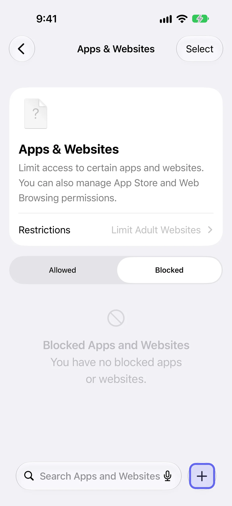
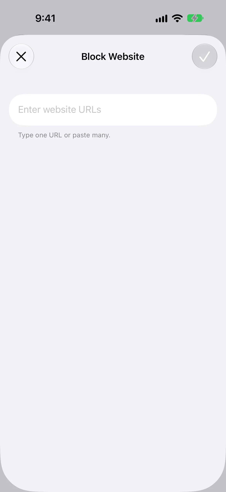
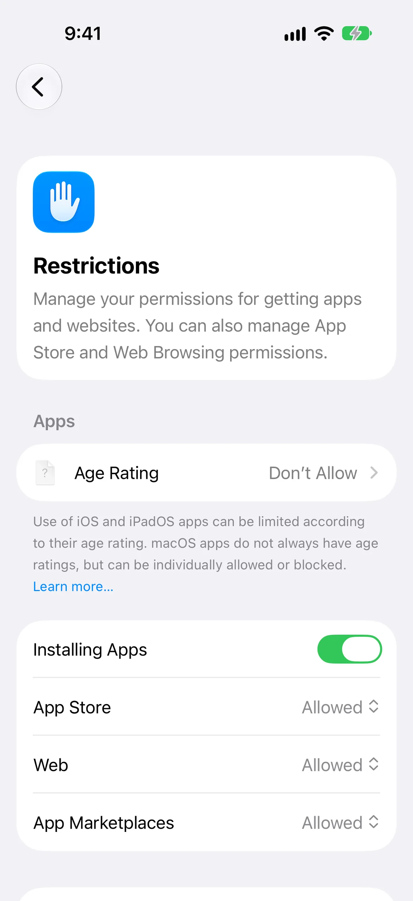

To block a website on iPhone with iOS 27, open **Settings → Screen Time → Apps & Websites**, tap **Blocked**, tap the add button, and type the site's address. It's free and built in. The catch is that you can undo it yourself, so this guide also shows how to lock websites with [LockPact](/go/b-how-to-block-websites-on-iphone/), a free-to-use app where a partner has to approve before a site opens again. It's written for adults managing their own phone; for a child's device, see Apple's [Apple Devices for Kids and Families](https://support.apple.com/guide/child-safety/jymj24zqwaek/27/web/1.0) guide.

## How do you block a website on iPhone?

On iOS 27, block a website from Apps & Websites in Screen Time. Open Settings, tap Screen Time, tap Apps & Websites, tap the Blocked tab, and tap the add button. A sheet titled Block Website asks you to type one URL or paste many. Confirm it and the site joins your Blocked list. This is the setting most people mean by "block a website on Safari."

1. Open **Settings → Screen Time → Apps & Websites**.

   
2. Tap the **Blocked** tab, then the **add button** at the bottom right.

   
3. On the **Block Website** sheet, type one URL or paste several, then tap the checkmark.

   
4. Check it worked: open the site in Safari and confirm it won't load.

<figure class="lp-video" style="margin: 1.5rem auto; max-width: 270px;">
<video controls muted playsinline preload="metadata" poster="/videos/how-to-block-websites-on-iphone.webp" width="270" height="587" style="width: 100%; height: auto; border-radius: 16px;">
<source src="/videos/how-to-block-websites-on-iphone.mp4" type="video/mp4">
</video>
<figcaption style="font-size: 0.8125rem; margin-top: 0.5rem; color: var(--color-text-tertiary);">Watch: 36-second walkthrough (no sound)</figcaption>
</figure>

To unblock a site later, go back to **Blocked** and remove the address. If a Screen Time passcode is set, you'll be asked for it.

## Why doesn't a website block hold, and how do you fix that?

A Screen Time website block holds only as long as you don't remove it, and you can, because you know the passcode. Apple's design assumes two people, a parent and a child, and no setting can lock the owner of an iPhone out of their own phone. The fix isn't a stricter setting. It's a second person who holds the code.

Three limits to know first. You list each site yourself, so a site with several addresses needs each one. Apple doesn't say which browsers the setting covers, so test any browser you use besides Safari. And whoever knows the passcode can open the same screen, remove the site and carry on.

To move the off-switch to someone else:

1. Block the site as above.
2. Ask your partner to set the passcode: **Settings → Screen Time → Manage Screen Time → Lock Screen Time Settings**, then a four-digit code.
3. Don't ask for the code at 11pm.

That makes removing the block a conversation, not a tap. It's harder to bypass, never impossible. Our guide to [changing, resetting or handing off your Screen Time passcode](/blog/screen-time-passcode/) covers the passcode in full, including recovery.

## Where does LockPact fit?

LockPact is for the moment the built-in block loses. You and a partner each choose what to lock on your own phones, apps and websites alike, and unlocking needs the other person's approval. Apple lets an app block up to 50 websites at once, and sites you lock show up in your selection as a count. If either of you bypasses it in Settings, which Apple always allows, the other is told straight away.

It's free to use, with optional Support LockPact and Willpower Waivers ($1.99–$9.99) that skip the short video before an unlock request. It's iPhone only and needs a partner you trust. [Get LockPact on the App Store](/go/b-how-to-block-websites-on-iphone/).

## How do you block adult websites on iPhone?

Apps & Websites has a Restrictions row at the top that shows the website filter, which reads Limit Adult Websites by default. Tap Restrictions to see it. Apple's iOS 27 guide describes three choices for a child's device: unrestricted access, Limit Adult Websites, or Approved Websites Only. Check which options your own screen offers.

1. Open **Settings → Screen Time → Apps & Websites**, tap **Restrictions**, then choose the website filter you want.

   

## Where did the website block move between iOS 26 and iOS 27?

On iOS 27 the website block moved from Content & Privacy Restrictions to Apps & Websites. The Web Content screen that older guides describe isn't in the iOS 27 Screen Time list, and Apple's iOS 27 pages describe Apps & Websites with Allowed and Blocked tabs instead. If your menus differ, check your version in Settings, General, About.

| | iOS 27 | iOS 26 and earlier |
|---|---|---|
| Where | Settings → Screen Time → **Apps & Websites** | Settings → Screen Time → **Content & Privacy Restrictions** |
| Block one site | **Blocked** tab → add button → **Block Website** sheet | **App Store, Media, Web & Games → Web Content → Limit Adult Websites → Add Website** (under Never Allow) |
| Adult-site filter | **Restrictions** row, reads Limit Adult Websites | **Web Content → Limit Adult Websites** |

## Which website block should you use?

If you want a quick block and trust yourself, Screen Time's Apps & Websites is enough: free, built in, a minute to set up. If you've blocked a site before and removed the block the next night, you need the off-switch to belong to someone else, through a passcode they hold or through LockPact.

For the wider picture, read [how to lock apps on iPhone](/blog/how-to-lock-apps-on-iphone/) and our [Screen Time guide](/blog/screen-time-iphone-guide/). If the site you keep returning to is a feed, [how to stop doomscrolling](/blog/how-to-stop-doomscrolling/) covers the habit as well as the setting.
