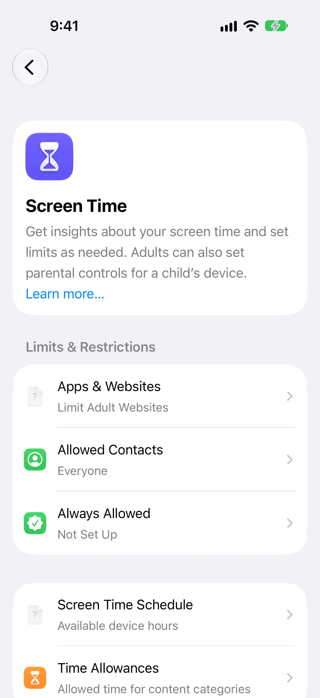
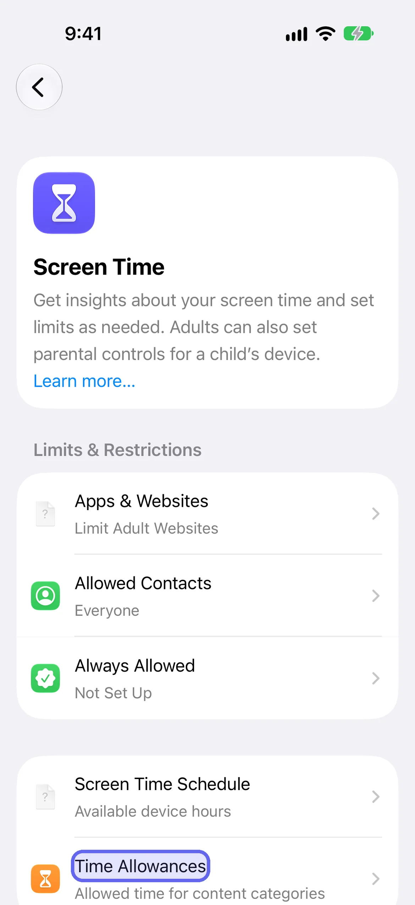
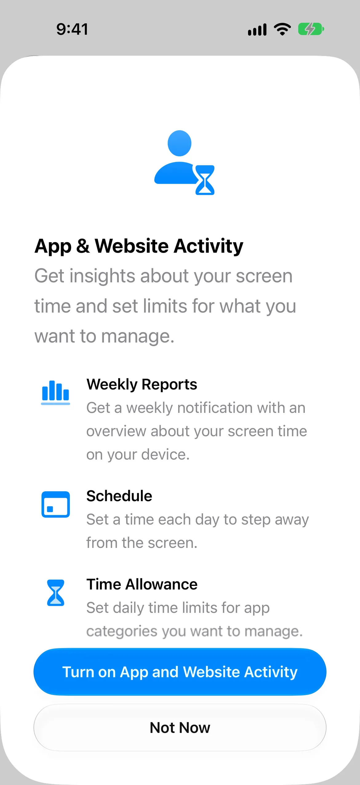
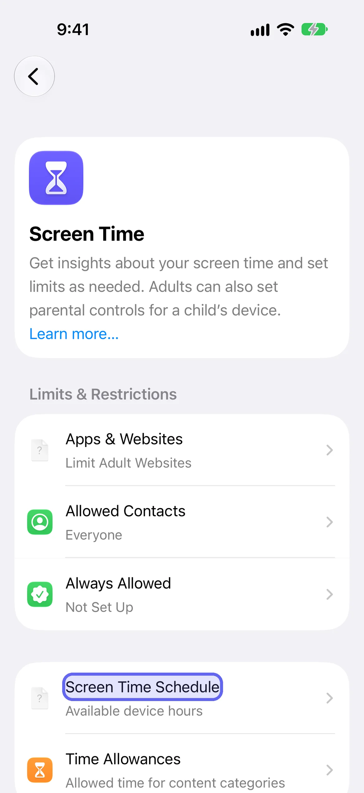
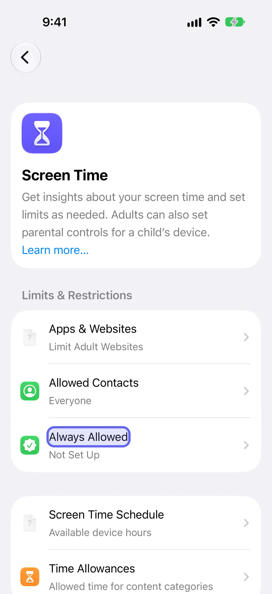
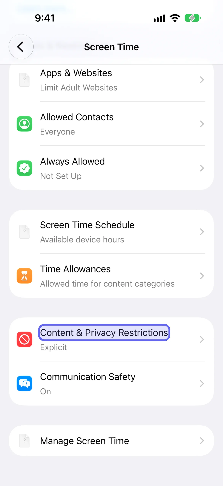
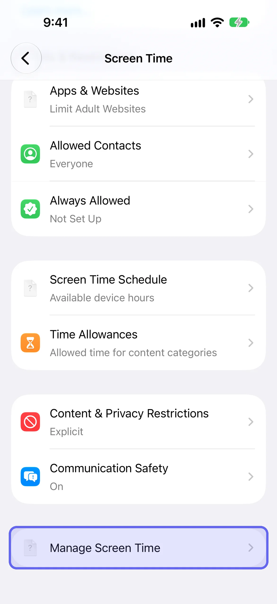

Screen Time is the free tool built into every iPhone for seeing how you use it and setting rules. This guide covers every setting on iOS 27 with the exact taps, then shows why it stops working when you set it for yourself and what to do about that. [LockPact](/go/b-screen-time-iphone-guide/) is a free-to-use app where a partner approves unlocks, for the cases Apple's settings can't cover.

## Where is Screen Time on iPhone, and what changed in iOS 27?

Screen Time is at **Settings → Screen Time**. On iOS 27 that screen lists Screen Time Schedule, Time Allowances, Always Allowed, Apps & Websites, Allowed Contacts, Content & Privacy Restrictions and Manage Screen Time. App Limits and Downtime, which iOS 26 and earlier use, no longer appear there. Apple's iOS 27 guide replaces them with Time Allowances and Screen Time Schedule.

1. Open **Settings**, then tap **Screen Time**.
2. You'll see the groups of settings described below.

If your menus show **App Limits** and **Downtime** instead, you're on iOS 26 or earlier. Each section below has a short note for that version.

## What do you need to use the iOS 27 Screen Time features?

You need iOS 27 on every Apple device that shares your Screen Time. Apple's note says that to use Screen Time Schedules and Time Allowances you need iOS 27, iPadOS 27, macOS 27, watchOS 27 or visionOS 27 or later on all your Apple devices. If you set these up for a child in a Family Sharing group, every device in the group must be updated too.

Check your version in **Settings → General → About**, and update in **Settings → General → Software Update**. If you can't update every device, the iOS 26 steps in each section below still apply to the phone you're holding.

If you're setting rules for a child rather than for yourself, Apple has a separate guide, "Apple Devices for Kids and Families". This page is about adults managing their own phone.

## How do you turn on Screen Time?

To turn on Screen Time on iOS 27, open Settings, tap Screen Time, then tap Screen Time Schedule, Time Allowances or Manage Screen Time, and tap Turn On App & Website Activity. Any of the three works, and turning it on starts the usage reports that the next two sections explain. You can add a Screen Time widget to your Home Screen for a quick look at your use.

1. Open **Settings → Screen Time**.
2. Tap **Screen Time Schedule**, **Time Allowances** or **Manage Screen Time**.
3. Tap **Turn On App & Website Activity**.

## How do you check Screen Time on iPhone?

To check your Screen Time, open Settings, tap Screen Time, then tap Daily Average. You'll see your usage, with a Week view and a Day view you can switch between. Scroll down for Pickups and Notifications, which show how many times you picked up your devices and how many notifications you got. Swipe left and right to move through your history.

1. Open **Settings → Screen Time**.
2. Tap **Daily Average**.
3. Tap **Week** for a weekly summary, or **Day** for a daily one.
4. Scroll down to see **Pickups** and **Notifications**.

Apple also sends a Screen Time weekly report notification once Screen Time is on. If it disappears, you can find it in Notification Center.

## How do you see Screen Time by app, by day and by week?

You see Screen Time by day or week with the Day and Week buttons under Daily Average. For the time you spend in each app, open Time Allowances, tap Manage Categories, tap a category, then tap an app. Apple describes this as the way to view your average daily use of apps within a category. Categories include Entertainment, Games and Social Media.

1. Open **Settings → Screen Time → Time Allowances**.
2. Tap **Manage Categories**, then tap a category.
3. Tap an app to see its average daily use.

## How do you set Time Allowances (iOS 27) or App Limits (iOS 26)?

On iOS 27 you set daily time for app categories with Time Allowances. Open Settings, tap Screen Time, tap Time Allowances, and drag the slider to set a total for your device or for a category. Apple says you can use apps in a category until they reach the category's allowance or the daily total. If an app has a website, the allowance covers both.

1. Open **Settings → Screen Time → Time Allowances**.
2. To change your total time, drag the slider left or right (or tap the minus and plus buttons).
3. To change a category, tap it under **Time Allowances** and drag its slider.
4. To add a category, tap **Manage Categories**, tap the plus button, then pick one.
5. To apply allowances only during certain hours, turn on **Match Screen Time Schedule**.

**On iOS 26 and earlier:** go to **Settings → Screen Time → App Limits → Add Limit**, choose categories or individual apps, tap **Next**, and set the time. Apple's note for those versions: by default, Screen Time limits can be ignored once reached.

## How do you set Downtime (Screen Time Schedule on iOS 27)?

On iOS 27 the Downtime idea is the Screen Time Schedule. Open Settings, tap Screen Time, tap Screen Time Schedule, and turn on Schedule. Tap Add Schedule, choose the days, then set time windows for things like work, dinner and the evening. Each window shows which Time Allowance categories are available during it, so you see what's open at a glance.

1. Open **Settings → Screen Time → Screen Time Schedule**, then turn on **Schedule**.
2. Tap **Add Schedule**, tap the days you want, then confirm.
3. Tap a **Time Window** to rename it, change its start or stop time, or choose Time Allowance categories.
4. To remove a window, tap it, then tap **Delete this Time Window**.

**On iOS 26 and earlier:** it's **Settings → Screen Time → Downtime**. Tap **Turn On Downtime Until Tomorrow**, or **Scheduled** to set it ahead of time. Apple sends a reminder five minutes before scheduled Downtime begins, which you can ignore or use to turn Downtime on early. With a Screen Time passcode set, **Block at Downtime** makes restricted apps unavailable, shown dimmed with an hourglass.

## What is Always Allowed?

Always Allowed is the list of apps and contacts that stay available regardless of any schedule or Time Allowance. Open Settings, tap Screen Time, tap Always Allowed, then tap Add Apps or Add People. Apple suggests family members or the Health app for emergencies. To remove one, tap Edit, then tap the minus button on the app or contact.

1. Open **Settings → Screen Time → Always Allowed**.
2. Tap **Add Apps** or **Add People**.
3. To remove an item, tap **Edit**, then tap the minus button on it.

## What is Apps & Websites on iOS 27?

Apps & Websites is the Screen Time screen for allowing or blocking specific apps and websites. On iOS 27 it sits under **Settings → Screen Time → Apps & Websites** and has an Allowed tab and a Blocked tab, a search field and an add button. A Restrictions row at the top shows the website filter, which reads Limit Adult Websites by default on the iOS 27 build we tested.

1. Open **Settings → Screen Time → Apps & Websites**.
2. Tap **Blocked** to see what's blocked, or **Allowed** to see what's allowed.
3. Tap the add button to add a website to block. The sheet is titled **Block Website** and asks you to type one URL or paste many.
4. Tap **Restrictions** to see the website filter.

Our [website blocking guide](/blog/how-to-block-websites-on-iphone/) covers this in full, including why you can undo it yourself.

## How do you use Content & Privacy Restrictions?

Content & Privacy Restrictions control what can be played, read or used. On iOS 27, open Settings, tap Screen Time, tap Content & Privacy Restrictions, and allow or block the settings under Content Restrictions, like Books, Movies, TV Shows and Music. Tap Other Features to allow or block built-in features such as AirDrop and Camera.

1. Open **Settings → Screen Time → Content & Privacy Restrictions**.
2. Under **Content Restrictions**, allow or block the types of content shown.
3. Tap **Other Features** to allow or block features such as AirDrop and Camera.
4. Tap **Siri** to block Siri, or allow it with or without AI capabilities.

For blocking websites, see [how to block websites on iPhone](/blog/how-to-block-websites-on-iphone/). On iOS 27 that setting sits under **Apps & Websites**.

## How do you set a Screen Time passcode?

A Screen Time passcode is a four-digit code you must enter before changing your Screen Time settings. On iOS 27, go to Settings, tap Screen Time, tap Manage Screen Time, tap Lock Screen Time Settings, then enter a four-digit passcode twice. Afterwards you can add Screen Time Passcode Recovery, which lets your Apple Account reset the code if you forget it.

1. Open **Settings → Screen Time → Manage Screen Time**.
2. Tap **Lock Screen Time Settings**.
3. Enter a four-digit passcode, then enter it again to confirm.

To change or remove it, use **Settings → Screen Time → Change Screen Time Passcode**. Our guide to [changing, resetting or handing off your Screen Time passcode](/blog/screen-time-passcode/) covers recovery and what to do if you forget it.

## How do you lock or hide a single app?

Locking one app is a separate feature from Screen Time. Touch and hold the app on your Home Screen, tap Require Face ID (or Touch ID or Passcode), then tap it again to lock the app. Opening it needs Face ID, Touch ID or your passcode, and it relocks each time you leave it. Apple says the locked state stays on that iPhone and doesn't sync through iCloud.

1. On the Home Screen, touch and hold the app until the Quick Actions menu opens.
2. Tap **Require Face ID** (or Touch ID or Passcode), then tap it again to confirm.
3. To lock and hide it, tap **Hide and Require Face ID**, authenticate, then tap **Hide App**.

Apps that come installed with the phone can't be hidden. Anyone with your face or passcode can undo it, so it protects against other people, not against you. The full set of built-in methods is in [how to lock apps on iPhone](/blog/how-to-lock-apps-on-iphone/).

## How do you share Screen Time across devices?

To share Screen Time across your iPhone, iPad and Mac, open Settings, tap Screen Time, tap Manage Screen Time, and turn on Share Across Devices. Your schedules, time allowances and usage then sync across every device signed in to the same Apple Account. Apple says this needs iOS 27, iPadOS 27 or macOS 27 or later on all your devices.

1. Open **Settings → Screen Time → Manage Screen Time**.
2. Turn on **Share Across Devices**.

## How do you turn Screen Time off?

To turn off Screen Time entirely on iOS 27, open Settings, tap Screen Time, tap Manage Screen Time, then tap Turn Off App & Website Activity. You can also turn off only your schedule: tap Screen Time Schedule and turn off Schedule. To remove a Time Allowance category, tap Time Allowances, tap Manage Categories, select the category, then choose Delete Category.

1. **Everything:** **Settings → Screen Time → Manage Screen Time → Turn Off App & Website Activity**.
2. **Schedule only:** **Settings → Screen Time → Screen Time Schedule**, then turn off **Schedule**.
3. **One category:** **Settings → Screen Time → Time Allowances → Manage Categories**, select the category, then **Delete Category**.

If you've set a Screen Time passcode, you'll be asked for it. That's the point of the next section.

## Why doesn't Screen Time hold when you set it for yourself?

Screen Time stops working on yourself because you know the passcode. You set the schedule and the allowances, you set the code, and the person who needs the limit is the same person who can undo it. Apple's design assumes two people, a parent and a child, and gives the owner of an iPhone control either way, so no setting can lock you out of your own phone.

What changes things is a second person. If a partner sets the Screen Time passcode and keeps it, removing a limit means asking them. Apple's documented route is **Manage Screen Time → Lock Screen Time Settings**, done on your phone by the person who will keep the code. Our guide to [why Screen Time isn't working](/blog/apple-screen-time-doesnt-work/) goes through what still fails even then.

## Where does LockPact fit?

LockPact is for the cases where handing over a passcode is awkward, or where you want the other person to decide each time. You and a partner each choose apps to lock on your own phones, and unlocking needs the other person's approval. If either of you bypasses it in Settings, which Apple always allows, the other is told straight away.

It's free to use. The only optional purchases are tips and Willpower Waivers, which skip the short video before an unlock request. It's iPhone only and needs someone willing to be your partner. [Get LockPact on the App Store](/go/b-screen-time-iphone-guide/).

## Which Screen Time guide do you need next?

- **Lock a single app or hide it:** [how to lock apps on iPhone](/blog/how-to-lock-apps-on-iphone/).
- **Block a website:** [how to block websites on iPhone](/blog/how-to-block-websites-on-iphone/).
- **Change, reset or hand off the passcode:** [Screen Time passcode](/blog/screen-time-passcode/).
- **Limits that keep getting overridden:** [Screen Time not working](/blog/apple-screen-time-doesnt-work/).
- **Focus modes versus Screen Time:** [can Focus mode block apps?](/blog/do-not-disturb-modes-comparison/).
- **Screen Time for adults, not children:** [Screen Time for adults on iPhone](/blog/screen-time-for-adults-iphone/).
- **Compare the apps:** [best screen time apps](/blog/best-screen-time-apps/).
