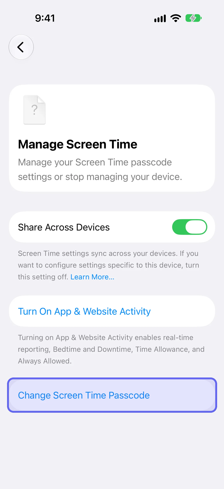
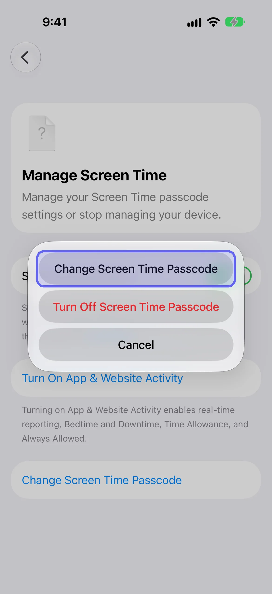

Your Screen Time passcode is the one thing standing between you and every limit you've set, and the person who knows it is usually the person it was meant to restrain. This guide covers Apple's iOS 27 steps to set, change, reset and remove it, then why someone else should hold it. [LockPact](/go/b-screen-time-passcode/) is a free-to-use app where a partner approves unlocks, for people who want that without handing over a code.

## What is the Screen Time passcode?

The Screen Time passcode is a four-digit code you must enter before changing your Screen Time settings. It isn't the code that unlocks your iPhone. Apple says to keep track of it because you need it to change the settings, limits or restrictions on your device. If Share Across Devices is on, a changed passcode updates your other devices automatically. Some guides still say six digits, which is the length of the code that unlocks the phone, not this one.

## How do you set a Screen Time passcode?

To set a Screen Time passcode on iOS 27, open Settings, tap Screen Time, tap Manage Screen Time, then tap Lock Screen Time Settings. Enter a four-digit passcode, then enter it again to confirm. Afterwards iOS asks whether you want Screen Time Passcode Recovery with an Apple Account. "Lock Screen Time Settings" is Apple's path for setting the passcode; it isn't a second code.

1. Open **Settings → Screen Time**, scroll down and tap **Manage Screen Time**.

   
2. Tap **Lock Screen Time Settings**.

   
3. Enter a four-digit passcode, then enter it again to confirm.

   
4. Add recovery: close the **Passcode Recovery** sheet and iOS asks whether you're sure. Tap **Provide Apple Account** to add recovery (enter the email or phone number and password), or **Skip** to go without.

   

<figure class="lp-video" style="margin: 1.5rem auto; max-width: 270px;">
<video controls muted playsinline preload="metadata" poster="/videos/screen-time-passcode.webp" width="270" height="587" style="width: 100%; height: auto; border-radius: 16px;">
<source src="/videos/screen-time-passcode.mp4" type="video/mp4">
</video>
<figcaption style="font-size: 0.8125rem; margin-top: 0.5rem; color: var(--color-text-tertiary);">Watch: 34-second walkthrough (no sound)</figcaption>
</figure>

Apple recommends you don't skip recovery, because it's how you reset a forgotten passcode. Remember which account you entered: Apple will ask for exactly that one later. Apple's support article notes the recovery account might differ from the one signed in on your phone, including a family member's, which matters if you're handing the passcode to a partner.

## Why shouldn't you be the one who holds the passcode?

Because the person who sets a limit for themselves and the person who wants to get around it are the same person, at different times. You decide at noon, and at 11pm the one holding the code is the version of you who'd like another hour. Apple says the passcode must be entered before you can change any Screen Time settings, but that only protects against someone who doesn't know it. A passcode works as a boundary only when somebody else is the only one who has it.

Hand it off the way you'd hand over anything you'd rather not have access to: your partner or a friend sets the passcode on your phone, picks the code themselves, and you don't ask for it at night. If you add recovery, a partner can enter their own Apple Account, so a reset goes through them, not you. It's harder to bypass, never impossible: no setting stops a determined phone owner, and Apple gives apps no way to prevent it. Third-party guides report that since iOS 26.4 the same passcode also gates switching off an app's Screen Time access and deleting the app; Apple's own pages don't spell that out, so test it on your phone.

Keep it adult-to-adult. This only works when you chose it. A passcode imposed on someone who didn't agree to it isn't accountability, and it's not what this page is about. For the full list of built-in locks and who can undo each, see [how to lock apps on iPhone](/blog/how-to-lock-apps-on-iphone/).

## Where does LockPact fit?

A passcode answers "can I quietly turn this off?" It doesn't tell anyone when you do. LockPact is a mutual lock: you each lock your own apps, your partner approves your unlock requests, and if either of you bypasses the lock in Settings, which Apple always allows, the other is told. It's free to use, with optional Support LockPact and Willpower Waivers ($1.99–$9.99) that skip the short video before an unlock request.

[Get LockPact on the App Store](/go/b-screen-time-passcode/). If you're blocking websites too, [how to block websites on iPhone](/blog/how-to-block-websites-on-iphone/) shows the setting, and our [complete Screen Time guide](/blog/screen-time-iphone-guide/) covers every setting.
## How do you change, reset or remove a Screen Time passcode?

To change it on iOS 27, open Settings, tap Screen Time, tap Manage Screen Time, and tap Change Screen Time Passcode. A sheet opens with Change Screen Time Passcode, Turn Off Screen Time Passcode and Cancel. Tap Change Screen Time Passcode again, enter your current passcode, then a new four-digit one twice. The option only appears once a passcode is set. Before that, the row reads Lock Screen Time Settings.

1. Open **Settings → Screen Time → Manage Screen Time**.
2. Tap **Change Screen Time Passcode**.

   
3. In the sheet, tap **Change Screen Time Passcode**.

   
4. If asked, enter the Apple Account email and password you used for recovery, then your current passcode. Enter a new four-digit passcode, then enter it again.

Apple's iPhone User Guide for iOS 27 words the same steps as "Tap Screen Time, tap Change Screen Time Passcode" ([Create, change, or remove a Screen Time passcode](https://support.apple.com/guide/iphone/iph272b4c4bd/27/ios/27)). Apple's support article, [Change your Screen Time passcode](https://support.apple.com/en-us/102677), lists it under Manage Screen Time, which is what you'll see on iOS 27.

### What if you forgot your Screen Time passcode?

Follow the same path and sign in with the Apple Account you used for Screen Time Passcode Recovery. Apple says that without that account you can't remove or reset the passcode, and Apple can't recover it for you. If the reset fails, check you're using exactly the email and password from setup, which may not be the account on your phone.

### What happens after failed passcode attempts?

Apple doesn't document a lockout timer for the Screen Time passcode. What it documents is the recovery path above: sign in with the Apple Account from setup and set a new code. Don't assume the delays that apply to your iPhone's unlock passcode also apply here, because Apple says the Screen Time passcode isn't the same code.

### How do you remove a Screen Time passcode?

Open **Settings → Screen Time → Manage Screen Time → Change Screen Time Passcode**, tap **Turn Off Screen Time Passcode** in the sheet (shown in red), and enter your current passcode. Removing it means anyone with your phone can change your Screen Time settings, so only do it when that's what you want. If you've forgotten the code, use recovery first.

