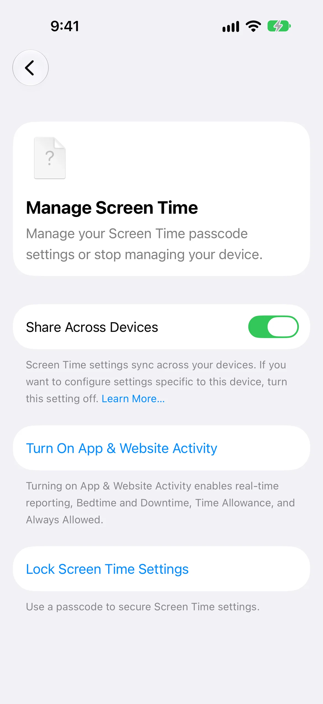
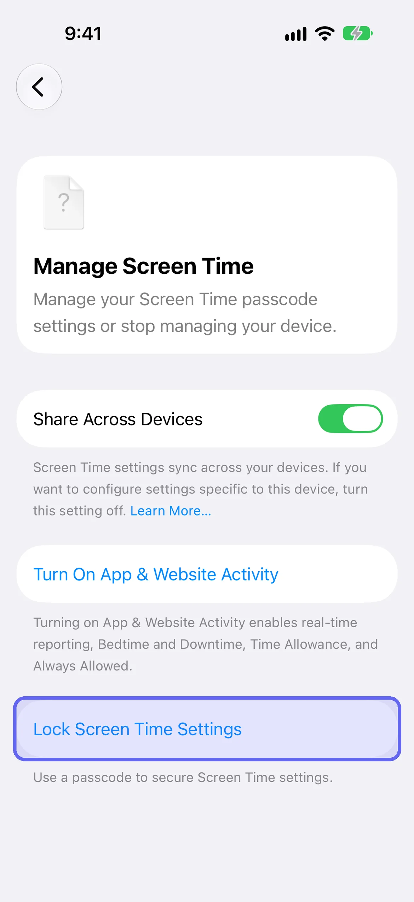
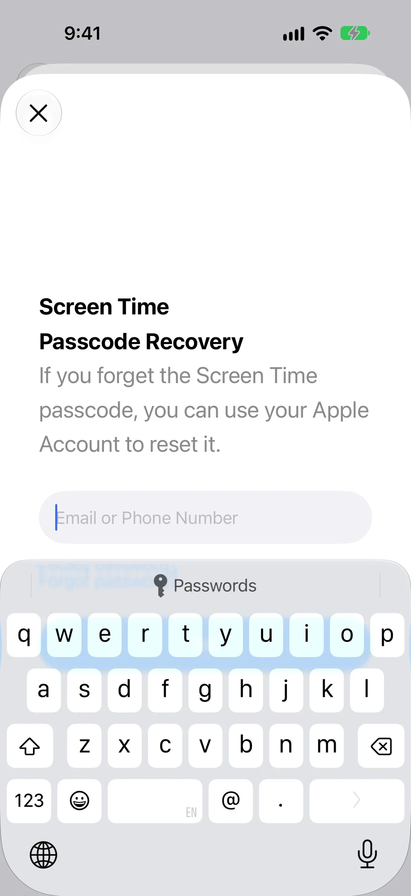

Your Screen Time passcode is the one thing standing between you and every limit you've set, and the person who knows it is usually the person it was meant to restrain. This guide covers Apple's iOS 27 steps to set, change, reset and remove it, with screenshots, then why someone else should hold it. [LockPact](/go/b-screen-time-passcode/) is a free-to-use app where a partner approves unlocks, for people who want that without handing over a code.

## What is the Screen Time passcode?

The Screen Time passcode is a four-digit code you must enter before changing your Screen Time settings. It isn't the code that unlocks your iPhone. Apple says it's important to keep track of it because you need it to change the settings, limits or restrictions on your device. If Share Across Devices is on, a changed passcode updates your other devices automatically.

It's four digits on iOS 27. Some guides still say six, which is the length of the code that unlocks the phone, not this one. Apple's iOS 27 guide says to enter a four-digit passcode and enter it again to verify it.

## How do you set a Screen Time passcode?

To set a Screen Time passcode on iOS 27, open Settings, tap Screen Time, tap Manage Screen Time, then tap Lock Screen Time Settings. Enter a four-digit passcode, then enter it again to confirm. Afterwards you can add Screen Time Passcode Recovery by entering an Apple Account, or skip that step. "Lock Screen Time Settings" is Apple's path for setting the passcode; it isn't a second code.

1. Open **Settings** and tap **Screen Time**.
2. Scroll down and tap **Manage Screen Time**.
3. Tap **Lock Screen Time Settings**.
4. Enter a four-digit passcode, then enter it again to confirm.

<figure class="lp-video" style="margin: 1.5rem auto; max-width: 270px;">
<video controls muted playsinline preload="metadata" poster="/videos/screen-time-passcode.webp" width="270" height="587" style="width: 100%; height: auto; border-radius: 16px;">
<source src="/videos/screen-time-passcode.mp4" type="video/mp4">
</video>
<figcaption style="font-size: 0.8125rem; margin-top: 0.5rem; color: var(--color-text-tertiary);">Screen recording: opening the Screen Time passcode screen on an iOS 27.0 Simulator, 34 seconds, no sound. The passcode is not set in the recording.</figcaption>
</figure>

## How do you set up Screen Time Passcode Recovery?

After you confirm the passcode, iOS 27 asks whether you're sure you want to skip recovery. Tap Provide Apple Account, then enter the email address or phone number and password for the Apple Account you want to use. Apple recommends you don't skip it, because it's how you reset a forgotten passcode. Remember which account you entered: Apple will ask for exactly that one later.

1. After confirming the passcode, the **Are you sure?** prompt appears. Tap **Provide Apple Account** to add recovery, or **Skip** to go without.
2. On the **Screen Time Passcode Recovery** sheet, enter the Apple Account email or phone number, then the password.

Apple's support article notes the recovery account might be different from the one signed in on your phone, including a family member's. That matters if you're handing the passcode to a partner, as the next sections explain. We didn't enter an Apple Account in the Simulator; the prompts above are as they appear before any account is entered.

## How do you change a Screen Time passcode?

To change it, open Settings, tap Screen Time, tap Change Screen Time Passcode, then tap Change Screen Time Passcode again. Enter your current passcode, then a new four-digit passcode twice. Apple's iPhone User Guide for iOS 27 lists this directly under Screen Time; Apple's support article lists the same option under Manage Screen Time. Look in both places if you don't see it.

1. Open **Settings → Screen Time → Change Screen Time Passcode**, then tap **Change Screen Time Passcode**. If it isn't there, open **Manage Screen Time** and look for it.
2. If asked, enter the Apple Account email and password you used to set up the passcode.
3. Enter your current passcode if prompted, then a new four-digit passcode, then the new one again.

We couldn't confirm in the Simulator which of Apple's two locations iOS 27 uses, because the option only appears once a passcode is set, and we didn't keep one set. That's why we give both.

## What if you forgot your Screen Time passcode?

Use the same Change Screen Time Passcode screen and sign in with the Apple Account you used for Screen Time Passcode Recovery. Apple says that without that account you can't remove or reset the passcode, and Apple won't be able to provide it. If the reset fails, check you're using exactly the email and password from setup, which may not be the account on your phone.

1. Open **Settings → Screen Time**, then **Change Screen Time Passcode** (or **Manage Screen Time → Change Screen Time Passcode**).
2. When asked, enter the Apple Account email and password you used for recovery.
3. Enter a new four-digit passcode, then enter it again.

## What happens after failed passcode attempts?

Apple doesn't document a lockout timer for the Screen Time passcode. What it documents is the recovery path: sign in with the Apple Account from setup and set a new code. Don't assume the delays that apply to your iPhone's unlock passcode also apply here, because Apple says the Screen Time passcode isn't the same code. If you've lost both the passcode and the recovery account, Apple says it can't recover the code for you.

## How do you remove a Screen Time passcode?

To remove it, open Settings, tap Screen Time, tap Change Screen Time Passcode, select Turn Off Screen Time Passcode, and enter your current passcode. Removing it means anyone with your phone can change your Screen Time settings, so only do it when that's what you want. If you've forgotten the code, use recovery first.

1. Open **Settings → Screen Time → Change Screen Time Passcode**.
2. Tap **Turn Off Screen Time Passcode**.
3. Enter your current passcode.

## What does the passcode actually protect?

It's the code Apple asks for when someone changes your Screen Time settings: your schedule, your Time Allowances and your content restrictions. Apple's page says the passcode must be entered before you can change any Screen Time settings. What it doesn't do is stop a determined phone owner. Apple gives third-party apps no way to prevent that, and no setting makes it impossible.

Third-party guides report that since iOS 26.4 the same passcode also gates switching off an app's Screen Time access and deleting the app; Apple's own pages don't spell that out, so test it on your phone. If you want the full picture of what each built-in lock does and who can undo it, [how to lock (or block) apps on iPhone](/blog/how-to-lock-apps-on-iphone/) covers every method.

## Why shouldn't you be the one who holds it?

Because the person who sets a limit for themselves and the person who wants to get around it are the same person, at different times. You decide at noon, and at 11pm the one holding the code is the version of you who'd like another hour. A passcode only works as a boundary when somebody else is the only one who has it.

Hand it off the way you'd hand over anything you'd rather not have access to: your partner or a friend sets the passcode on your phone, picks the code themselves, and you don't ask for it at night. If you add Passcode Recovery, remember that Apple lets the recovery account differ from the one on your phone. A partner can enter their own Apple Account, so a reset goes through them, not you.

Keep it adult-to-adult. This only works when you chose it. A passcode imposed on someone who didn't agree to it isn't accountability, and it's not what this page is about.

## Where does LockPact fit?

A passcode answers "can I quietly turn this off?" It doesn't tell anyone when you do. LockPact is a mutual lock: you each lock your own apps, your partner approves your unlock requests, and if either of you bypasses the lock in Settings, which Apple always allows, the other is told. It's free to use, with optional tips and Willpower Waivers that skip the short video before an unlock request.

[Get LockPact on the App Store](/go/b-screen-time-passcode/). If you're blocking websites too, [how to block websites on iPhone](/blog/how-to-block-websites-on-iphone/) shows the setting and why who holds the code matters, and our [complete Screen Time guide](/blog/screen-time-iphone-guide/) covers every setting.
